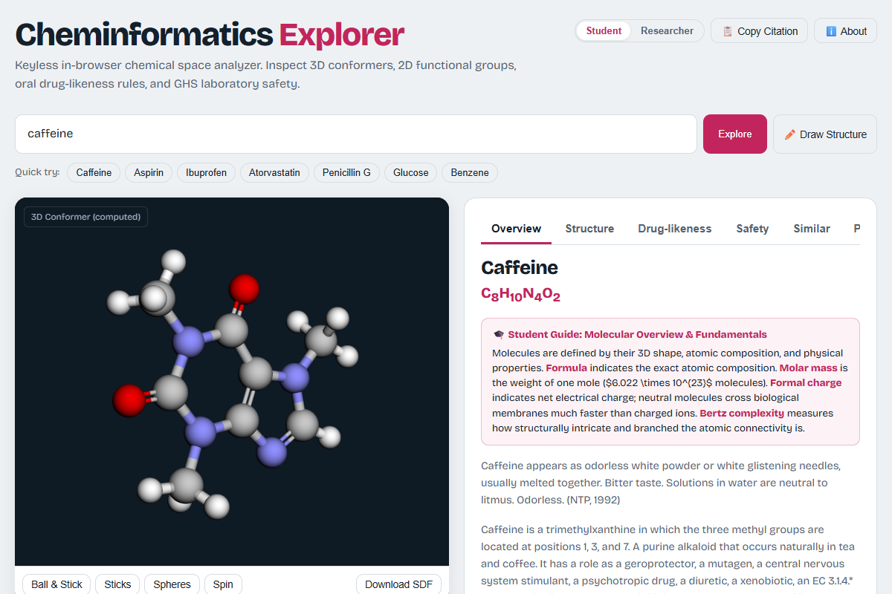
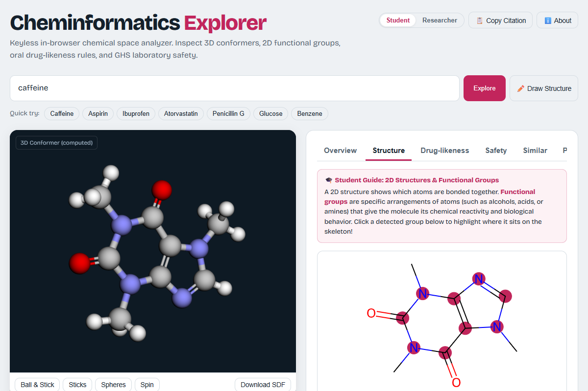
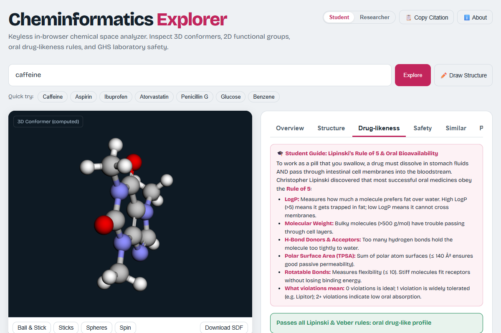

# Cheminformatics Explorer

**Live Application:** [https://asmita-ai.github.io/cheminformatics-explorer/](https://asmita-ai.github.io/cheminformatics-explorer/)

[](https://opensource.org/licenses/MIT)
[](https://github.com/asmita-ai/cheminformatics-explorer/actions/workflows/deploy.yml)
[](https://zenodo.org/)

**Cheminformatics Explorer** is an open-source, keyless, client-side web application designed to help chemistry students, educators, and pharmaceutical researchers explore chemical space interactively. By integrating hardware-accelerated 3D conformer graphics (3Dmol.js), in-browser 2D chemical structure graph depictions with functional group SMARTS substructure highlighting (RDKit.js WASM), oral drug-likeness evaluation (Lipinski Rule of 5 and Veber rules), medicinal chemistry structural alerts (PAINS and Brenk filters), and aggregated laboratory safety classifications (UN GHS via PubChem PUG View), this workbench bridges the gap between complex computational chemistry tools and accessible educational software without requiring server backends, database installations, or API tokens.

---

## Live Demo

The application runs entirely in the browser and requires no installation, configuration, or API keys:  
🌐 **[https://asmita-ai.github.io/cheminformatics-explorer/](https://asmita-ai.github.io/cheminformatics-explorer/)**

---

## Statement of Need

Undergraduate chemistry education and early-stage drug discovery research often require access to diverse cheminformatics software packages to visualize 3D molecular conformations, analyze physicochemical properties, inspect functional groups, and check oral bioavailability criteria. Existing industrial tools (e.g., Schrödinger Maestro, MOE, Pipeline Pilot) are proprietary, cost-prohibitive, and computationally heavy, while command-line Python workflows (such as native RDKit) impose steep programming barriers for chemistry students and laboratory scientists. 

Conversely, standard chemical web search portals typically present static property tables without interactive substructure manipulation, structural alert screening, or student-friendly pedagogical guidance. Cheminformatics Explorer addresses this need by providing a responsive, single-file browser application that instantly resolves chemical names, formulas, and SMILES strings, executes client-side descriptor calculations, and transparently annotates every value as either *computed* or *experimental* alongside its literature provenance.

---

## Features

- **Interactive 3D Molecular Graphics:** WebGL-accelerated 3D conformer rendering powered by 3Dmol.js. Supports Ball & Stick, Sticks, and Spheres representations with continuous spin control, perspective zooming, and MDL SDF coordinate downloads.
- **RDKit.js 2D Structure Depiction & SMARTS Highlighting:** Pure client-side WebAssembly 2D coordinate generation. Interactive substructure buttons detect and highlight key functional groups (e.g., carboxylic acids, esters, amides, amines, alcohols, ketones, halides, aromatic systems) directly on the vector SVG canvas.
- **Dual-Audience Learning Layer:** Instant toggle between **Student** and **Researcher** modes without reloading:
  - *Student Mode:* Plain-language conceptual explanations (e.g., why LogP dictates cellular membrane permeation vs. water solubility) and laboratory PPE recommendations.
  - *Researcher Mode:* Formal mathematical descriptors, exact InChIKey/SMILES strings, explicit SMARTS patterns, and literature citations.
- **Oral Drug-Likeness & Medicinal Chemistry Filters:** Automated evaluation against Lipinski's Rule of 5 (MW $\le 500$, XLogP $\le 5$, HBD $\le 5$, HBA $\le 10$) and Veber criteria (TPSA $\le 140$ Ų, Rotatable Bonds $\le 10$). Side-by-side comparison of empirical atom-additive XLogP3-AA with RDKit Wildman-Crippen fragmental logP, Fraction $sp^3$ carbons ($F_{sp3}$), ring counts, and PAINS / Brenk reactive structural alert filters.
- **GHS Laboratory Hazard Classifications:** Aggregated manufacturer and regulatory safety data via PubChem PUG View, displaying official GHS pictograms, signal words (Danger / Warning), hazard statement codes, and laboratory handling precautions.
- **2D Structural Similarity Search:** PubChem `fastsimilarity_2d` integration identifying structurally related molecules (Tanimoto coefficient $\ge 85\%$) with dynamically drawn 2D thumbnails and one-click loading.
- **Experimental Bench Properties & Biological Ontologies:** Real bench-measured physical properties (melting point, boiling point, solubility, density) with source literature citations, paired with ChEBI biological roles and ChEMBL clinical trial phases.
- **Alternative Chemical Input Modalities:** Direct chemical SMILES structure query resolution alongside an integrated 2D JSME molecule sketcher drawer.
- **Comparative Molecular Analysis:** Side-by-side descriptor matrix with quantitative delta ($\Delta$) computations for two molecules simultaneously.
- **Client-Side Optimization & Privacy:** Zero tracking, zero analytics, strictly keyless. Enforces a client-side request queue ($\le 3$ requests/sec) with exponential backoff on HTTP 429/503 and 24-hour `sessionStorage` caching.
- **Accessibility:** 100% Axe-Core compliance across WCAG 2.1 Level AA rules, visible focus rings, ARIA landmarks, and 360 px viewport zero-horizontal-scroll layout.

---

## Screenshots

| Caffeine 3D Conformer &amp; Molecular Overview | Caffeine 2D Vector Depiction &amp; Functional Group Highlight |
|:---:|:---:|
|  |  |

| Caffeine Oral Drug-Likeness &amp; Wildman-Crippen LogP |
|:---:|
|  |

---

## Primary Data Sources

| Source | Domain / Scope | Access Protocol | Data License / Terms |
|---|---|---|---|
| **PubChem** | Chemical records, 3D conformers, physical properties, synonyms | PUG REST & PUG View | US Public Domain (NCBI / NLM / NIH) |
| **RDKit.js MinimalLib** | 2D coordinate generation, SVG depiction, Crippen logP, SMARTS | In-browser WebAssembly | BSD 3-Clause License |
| **3Dmol.js** | WebGL hardware-accelerated 3D conformer rendering | In-browser WebGL | BSD 3-Clause License |
| **JSME Sketcher** | Interactive 2D chemical structure drawing applet | In-browser JavaScript | BSD 3-Clause License |
| **NCI CIR** | Secondary compound name and InChIKey resolution | HTTPS REST | US Public Domain (NIH / NCI) |
| **ChEBI** | Chemical Entities of Biological Interest ontology roles | EMBL-EBI OLS4 REST API | Creative Commons CC BY 4.0 |
| **ChEMBL** | Drug clinical trial phase and bioactivity report cards | EMBL-EBI REST API | Creative Commons CC BY-SA 3.0 |

---

## Scientific Limitations

1. **Computed vs. Experimental 3D Conformers:** 3D coordinates retrieved from PubChem represent theoretical, energy-minimized conformers computed using the MMFF94s molecular mechanics force field. They do not represent experimentally determined single-crystal X-ray diffraction (XRD) or neutron scattering crystal structures.
2. **Entries without 3D Records:** Pure elemental metals (e.g., mercury, gold), ionic mineral salts (e.g., sodium chloride), and ill-defined stereoisomeric mixtures lack 3D records in PubChem. When coordinate records are absent, the application falls back to 2D depictions with explicit user labeling.
3. **Computational logP Divergence:** Discrepancies between PubChem XLogP3-AA and RDKit Crippen logP are expected ($0.5$ to $1.5$ log units). XLogP3-AA utilizes an empirical atom-additive prediction calibrated with experimental training sets, whereas RDKit Crippen logP sums 68 Wildman-Crippen atomic environment fragment contributions. Neither value is measured bench data.
4. **GHS Supplier Notification Variance:** Safety data represents aggregated vendor hazard submissions under UN GHS, EU CLP, and OSHA HazCom. Reported hazard statements and classification severities may vary depending on chemical manufacturer, grade, and impurity profiles.

---

## Development Statement

This tool was conceived, directed and scientifically validated by Asmita Karmakar, an M.Sc. Chemistry graduate without a formal programming background. The source code was written with the assistance of generative AI tools under the author's direction. The author defined the scope, selected the data sources, reviewed the outputs and checked results against known compounds. The author takes responsibility for the content. Errors may remain, so please report issues on GitHub.

---

## Running Locally

Because Cheminformatics Explorer is a self-contained, client-side web application without a server or build step, running it requires no npm install or compiler:

```bash
# Clone the repository
git clone https://github.com/asmita-ai/cheminformatics-explorer.git
cd cheminformatics-explorer

# Option A: Open directly in any modern browser
# Double-click index.html or open via browser file dialog

# Option B: Serve via Python static server (recommended for WebAssembly module loading)
python -m http.server 8000
# Then navigate to http://localhost:8000/
```

---

## How to Cite

If you utilize Cheminformatics Explorer in educational curricula, academic coursework, or published scientific research, please cite the application using the following BibTeX format or refer to [`CITATION.cff`](CITATION.cff):

```bibtex
@software{Karmakar_Cheminformatics_Explorer_2026,
  author       = {Karmakar, Asmita},
  title        = {{Cheminformatics Explorer: Keyless Client-Side Chemical Space Workbench}},
  year         = {2026},
  version      = {1.0.0},
  publisher    = {GitHub},
  url          = {https://github.com/asmita-ai/cheminformatics-explorer},
  doi          = {10.5281/zenodo.placeholder}
}
```

---

## Contributing & Issues

Contributions, bug reports, and suggestions from chemistry educators, students, and cheminformatics researchers are welcome. Please open an issue or submit a pull request on the [GitHub repository](https://github.com/asmita-ai/cheminformatics-explorer/issues).

---

## Third-Party Notices & Licenses

Cheminformatics Explorer relies on open-source scientific software packages and public data APIs:

1. **RDKit.js MinimalLib:** Copyright © 2006–2024 Greg Landrum and RDKit contributors. Distributed under the **BSD 3-Clause License**.
2. **3Dmol.js:** Copyright © 2014–2024 Nicholas Rego and David Koes (University of Pittsburgh). Distributed under the **BSD 3-Clause License**.
3. **JSME Molecule Editor:** Copyright © 2012–2024 Peter Ertl and Bruno Bienfait. Distributed under the **BSD 3-Clause License**. Free for academic, educational, research, and commercial use. Reference: *Bienfait, B., Ertl, P. JSME: a free molecule editor in JavaScript. J. Cheminform. 5, 24 (2013).*
4. **Bricolage Grotesque Font:** Copyright © 2023 Mathieu Triay. Distributed under the **SIL Open Font License, Version 1.1**.

---

## License

This project is licensed under the **MIT License** — see the [`LICENSE`](LICENSE) file for complete details.
